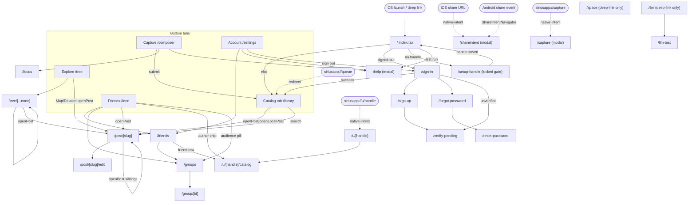

# Mobile routes, navigation flow & header audit (living map)

The authoritative index of **every** screen in `apps/mobile`, the exact URL that
opens it, the navigation edges between screens (with source `file:line`
citations), each pushed screen's native-header/back-button registration status,
and the main end-to-end user journeys. Keep this file in sync when you add,
rename, remove, or re-wire a route under `src/app/`.

---

## ⚠️ REVALIDATE ON READ — this doc is a fast index, NOT ground truth

This file is a **map**, not the territory. Source drifts; line numbers move the
moment anyone edits a file above the cited line. Therefore:

1. **Before you act on any route or edge listed here, open the cited
   `file:line` and confirm it still exists and still says what this doc claims.**
   Do not deep-link, wire a new push, or reason about a flow purely from this
   table.
2. **If reality differs from this doc, fix the doc in the SAME change.** A stale
   map is worse than no map. Update the affected row(s) AND the summary counts.
3. Line numbers are *approximate anchors*. If the cited line no longer matches,
   re-grep (see "How to regenerate" below) rather than trusting the number.

### How to regenerate / keep updated

Re-run these three sweeps from `apps/mobile/`; they are the exact sources this
doc was built from:

```sh
# (a) Enumerate every route file
find src/app -type f \( -name '*.tsx' -o -name '*.ts' \) | sort

# (b) Every navigation edge (router.*, <Redirect>, <Link>, guarded helpers)
grep -rn -E "router\.(push|navigate|replace|back|dismiss)|<Redirect|href=|openPost|openLocalPost|openPostEdit" \
  --include="*.tsx" --include="*.ts" src | sort

# (c) The header/back registrations (one <Stack.Screen> per pushed page)
sed -n '/<Stack screenOptions/,/<\/Stack>/p' src/app/_layout.tsx
```

Then reconcile: `src/app/_layout.tsx` (root stack + header registrations),
`src/app/(tabs)/_layout.tsx` (tab labels), `src/app/(auth)/_layout.tsx` (auth
stack), `src/app/+native-intent.ts` (deep-link rewrites), and
`src/lib/nav.ts` (the guarded `openPost*` helpers that funnel all `/post/*`
navigation).

---

## The three facts that bite everyone (do not lose these)

1. **The URL scheme is `siriusapp://`.** Declared once in `app.json`
   (`expo.scheme`). The bundle id `dev.copt.sirius` is **NOT a URL scheme** — it
   is only the id you pass to `xcrun simctl launch <udid> dev.copt.sirius` to
   cold-launch the binary. Deep links use `siriusapp://`, e.g. `siriusapp://tree`.
   Any comment showing `dev.copt.sirius://…` is wrong.
2. **Tab UI labels ≠ route names.** All 5 bottom-tab labels differ from their
   file/route names (`src/app/(tabs)/_layout.tsx`). The route is the **file
   name**, not the label.
3. **There is NO `/explore` route.** The tab labeled "Explore" is the `/tree`
   route (kept named `tree` so `/tree/[...node]` drill links + old deep links
   resolve). `siriusapp://explore` → **Unmatched Route**. Use `siriusapp://tree`.
   Also: **the Friends tab is `feed`, NOT `friends`** — `app/friends.tsx` already
   owns `/friends` (the off-tab People manager pushed from Account), so a
   `(tabs)/friends` route would collide.

---

## 1. Route classifications

Legend: **TAB** = a `(tabs)` screen · **AUTH** = `(auth)` screen · **MODAL** =
`presentation: "modal"` · **REDIRECT** = renders only a `<Redirect>` ·
**PUSHED-CONTENT** = a stack page pushed on top of the tabs (needs a header) ·
**ENTRY** = an OS/deep-link landing target · **GATE** = a locked full-screen
step reached only by replace-redirect (no header, no back).

### Tabs — `src/app/(tabs)/` (label ≠ route)

Labels are set in `(tabs)/_layout.tsx` via `NativeTabs.Trigger.Label`; the
signed-out redirect to `/(auth)/sign-in` lives at `(tabs)/_layout.tsx:130`, the
terms gate renders in place of the navigator at `(tabs)/_layout.tsx:139`, and
the no-handle redirect to `/setup-handle` at `(tabs)/_layout.tsx:161` (order
mirrors web: session → terms → handle).

| Tab label (UI) | Route / file | Deep link | Purpose | `_layout.tsx` label line |
| --- | --- | --- | --- | --- |
| Capture | `composer` — `(tabs)/composer.tsx` | `siriusapp://composer` | The composer: submit URLs/notes/images. Primary action, leads the row. | `(tabs)/_layout.tsx:57` |
| Catalog | `library` — `(tabs)/library.tsx` | `siriusapp://library` | Private post archive + the in-flight status board (server queue + local outbox). | `(tabs)/_layout.tsx:61` |
| Friends | `feed` — `(tabs)/feed.tsx` | `siriusapp://feed` | Merged shared-posts feed (own SHARED + friends'/public). | `(tabs)/_layout.tsx:70` |
| Explore | `tree` — `(tabs)/tree.tsx` | `siriusapp://tree` | Map (inline 3D `<MapView>`) / Categories / Focus toggle over the embedding scene. | `(tabs)/_layout.tsx:74` |
| Account | `settings` — `(tabs)/settings.tsx` | `siriusapp://settings` | Profile, subscription, sign-out, links to Friends/Help/archive. | `(tabs)/_layout.tsx:81` |

**Queue is no longer a tab.** The "in flight" board folded into the Catalog tab
(`(tabs)/library.tsx`). The legacy deep link `siriusapp://queue` still resolves
via the root `app/queue.tsx` redirect (see below).

### Top-level stack routes — `src/app/`

| Route | File | Class | Purpose |
| --- | --- | --- | --- |
| `/` | `index.tsx` | ENTRY / REDIRECT | Boot router: `→ /(auth)/sign-in` if signed-out (`index.tsx:59`), `→ /setup-handle` if the signed-in user has no handle (`index.tsx:60`), `→ /help` on first run (`index.tsx:65`), else `→ /(tabs)/library` (`index.tsx:63`). |
| `/setup-handle` | `setup-handle.tsx` | GATE | **Mandatory-handle gate** (mobile mirror of web's `/setup-handle`). A signed-in user with no handle is locked here — redirected from both `index.tsx:60` and `(tabs)/_layout.tsx:161` — and cannot enter the tabs until a handle saves via `POST /api/app/me/handle` (the SAME endpoint web uses; server validates shape/reserved/uniqueness). No skip, no header/back, `gestureEnabled:false`. On success it refetches the session and `<Redirect href="/">` resumes the boot chain (`setup-handle.tsx:143`); signed-out → `/(auth)/sign-in` (`setup-handle.tsx:138`). |
| `/capture` | `capture.tsx` | MODAL / ENTRY | App Intents / Shortcuts / Siri capture pane. `siriusapp://capture?text=<encoded>` (host or first segment, see `+native-intent.ts`). Presented modal. |
| `/shareintent` | `shareintent.tsx` | MODAL / ENTRY | Share-extension landing. NOT linked directly. iOS: `+native-intent.ts` rewrites the synthetic share URL here. Android: `ShareIntentNavigator` in `_layout.tsx:144` pushes here off `hasShareIntent`. Presented modal. |
| `/help` | `help.tsx` | MODAL | "How Sirius works" hub + first-run onboarding. Presented modal. |
| `/focus` | `focus.tsx` | PUSHED-CONTENT | Focus-area picker. Reached only from Capture. |
| `/friends` | `friends.tsx` | PUSHED-CONTENT | People manager (friend requests/list). Pushed from Account & Feed. |
| `/groups` | `groups.tsx` | PUSHED-CONTENT | Share-groups manager: lists groups + create flow. Pushed from Friends/Feed. `siriusapp://groups?group=<id>` pre-selects. |
| `/group/[id]` | `group/[id].tsx` | PUSHED-CONTENT | Group editor: rename, privacy, add/remove members, delete. Sets live title inline. |
| `/space` | `space.tsx` | PUSHED-CONTENT | Full-screen 3D embedding space. **No in-app push edge today** (deep-link only — the Explore tab renders its Map inline via `<MapView>`, it does NOT navigate here). See discrepancy note. |
| `/llm` | `llm.tsx` | PUSHED-CONTENT | On-device model download + chat. Hidden unless `EXPO_PUBLIC_ON_DEVICE_AI=true`. **No in-app push edge today** (composer on-device drafting is parked, `composer.tsx:199`); deep-link only. |
| `/llm-test` | `llm-test.tsx` | PUSHED-CONTENT | Dev-only draft/ask bench. `siriusapp://llm-test?run=all\|ask`. Reached from `/llm` (`llm.tsx:595`). |
| `/queue` | `queue.tsx` | REDIRECT | Back-compat: `<Redirect href="/library">` (`queue.tsx:9`). |
| `/post/[slug]` | `post/[slug]/index.tsx` | PUSHED-CONTENT | Post detail (server post). `siriusapp://post/<slug>`. |
| `/post/[slug]/edit` | `post/[slug]/edit.tsx` | PUSHED-CONTENT | Post editor. |
| `/post/local/[localId]` | `post/local/[localId].tsx` | PUSHED-CONTENT / REDIRECT | Offline-mirror draft; if it has a server slug it `<Redirect>`s to `/post/[slug]` (`post/local/[localId].tsx:56`). |
| `/tree/[...node]` | `tree/[...node].tsx` | PUSHED-CONTENT | Explore drill-in (catch-all). `siriusapp://tree/<node>/<child>…`. |
| `/u/[handle]` | `u/[handle]/index.tsx` | PUSHED-CONTENT / ENTRY | Friend invite / profile landing. `siriusapp://u/<handle>` (normalized in `+native-intent.ts`). Folder route (hosts sibling `catalog`). |
| `/u/[handle]/catalog` | `u/[handle]/catalog.tsx` | PUSHED-CONTENT / ENTRY | A friend's catalog. `siriusapp://u/<handle>/catalog`. |

### Auth group — `src/app/(auth)/` (resolve without the group prefix)

Stack header is **off** for the whole group (`(auth)/_layout.tsx:19`,
`headerShown: false`); if a session exists the layout `<Redirect>`s to
`/(tabs)/library` (`(auth)/_layout.tsx:17`).

| Route | File | Purpose |
| --- | --- | --- |
| `/sign-in` | `(auth)/sign-in.tsx` | Email+password sign-in. |
| `/sign-up` | `(auth)/sign-up.tsx` | Registration. |
| `/forgot-password` | `(auth)/forgot-password.tsx` | Request reset email. |
| `/reset-password` | `(auth)/reset-password.tsx` | Consume reset token / set new password. |
| `/verify-pending` | `(auth)/verify-pending.tsx` | "Check your email to verify" holding screen. |

---

## 2. Root stack header registration (`src/app/_layout.tsx`)

The root stack sets `screenOptions={{ headerShown: false }}` globally
(`_layout.tsx:247`). Every **pushed content page** that needs a native header +
back arrow is registered individually with `headerShown: true`. **A pushed route
NOT registered here renders with no back arrow and no top padding (content
collides with the status bar)** — that is the bug class this table audits.

| `<Stack.Screen name>` | `_layout.tsx` lines | headerShown | title | headerBackTitle | presentation |
| --- | --- | --- | --- | --- | --- |
| `index` | 248 | (inherits false) | — | — | — |
| `(auth)` | 249 | (inherits false) | — | — | — |
| `(tabs)` | 250 | (inherits false) | — | — | — |
| `shareintent` | 251–254 | inherits false | — | — | **modal** |
| `capture` | 255–258 | inherits false | — | — | **modal** |
| `help` | 259–262 | inherits false | — | — | **modal** |
| `post/[slug]/index` | 263–266 | **true** | `""` | (default) | push |
| `post/[slug]/edit` | 267–276 | **true** | `Edit` | `Post` | push |
| `post/local/[localId]` | 277–286 | **true** | `""` | `Catalog` | push |
| `tree/[...node]` | 287–298 | **true** | `Index` | `Tree` | push |
| `focus` | 299–307 | **true** | `Focus` | `Capture` | push |
| `space` | 308–316 | **true** | `Space` | `Catalog` | push |
| `friends` | 317–325 | **true** | `Friends` | `Account` | push |
| `groups` | 326–334 | **true** | `Groups` | `Friends` | push |
| `group/[id]` | 335–345 | **true** | `Group` (live name set inline) | `Groups` | push |
| `u/[handle]/index` | 351–360 | **true** | `Profile` | `Back` | push |
| `u/[handle]/catalog` | 361–370 | **true** | `Catalog` | `Back` | push |
| `llm` | 371–384 | **true** | `On-device AI` | `Capture` | push |
| `llm-test` | 385–393 | **true** | `Draft test bench` | (default) | push |

### Header audit — every PUSHED-CONTENT route

| Route | Registered w/ header? | headerBackTitle | Note |
| --- | --- | --- | --- |
| `/post/[slug]` | ✅ `_layout.tsx:263` | (default — derived from previous route) | title intentionally `""`. |
| `/post/[slug]/edit` | ✅ `_layout.tsx:267` | `Post` | |
| `/post/local/[localId]` | ✅ `_layout.tsx:277` | `Catalog` | |
| `/tree/[...node]` | ✅ `_layout.tsx:287` | `Tree` | |
| `/focus` | ✅ `_layout.tsx:299` | `Capture` | |
| `/space` | ✅ `_layout.tsx:308` | `Catalog` | Registered even though no in-app edge reaches it. |
| `/friends` | ✅ `_layout.tsx:317` | `Account` | |
| `/groups` | ✅ `_layout.tsx:326` | `Friends` | |
| `/group/[id]` | ✅ `_layout.tsx:335` | `Groups` | |
| `/u/[handle]` | ✅ `_layout.tsx:351` | `Back` | |
| `/u/[handle]/catalog` | ✅ `_layout.tsx:361` | `Back` | |
| `/llm` | ✅ `_layout.tsx:371` | `Capture` | |
| `/llm-test` | ✅ `_layout.tsx:385` | (default) | |

**Result: every PUSHED-CONTENT route is header-registered. None missing.**
Modal (`shareintent`, `capture`, `help`), redirect (`index`, `queue`), and gate
(`setup-handle` — a locked full-screen step reached only by `replace`; it sets
its own inline `<Stack.Screen options={{ headerShown: false, gestureEnabled:
false }}>` so there is deliberately no back affordance) routes intentionally
have no header. Keep this table as the ongoing audit surface: when
adding a pushed page, add its `<Stack.Screen headerShown:true …>` in the same
change and add a row here.

---

## 3. Navigation flow graph

### Guarded `/post/*` helpers — `src/lib/nav.ts`

All post navigation funnels through `src/lib/nav.ts` (a short-window dedupe kills
double-push of the same slug):

- `openPost(slug, from?)` → `/post/<slug>[?from=<label>]` (`nav.ts:33`)
- `openLocalPost(localId, from?)` → `/post/local/<localId>[?from=<label>]` (`nav.ts:37`)
- `openPostEdit(slug)` → `/post/<slug>/edit` (`nav.ts:43`)

The `from` label is what the destination header's back button shows (e.g.
"Catalog", "Explore", "Search", "Friends", "Related", "Space", "Chat").

### (a) Adjacency — reached-from / navigates-to

**`/` (`index.tsx`)** → `/(auth)/sign-in` (`index.tsx:59`) · `/setup-handle`
(no handle, `index.tsx:60`) · `/(tabs)/library` (`index.tsx:63`) · `/help`
(`index.tsx:65`). Reached: OS launch, and `/setup-handle` on success.

**`/setup-handle` (`setup-handle.tsx`)** → `/(auth)/sign-in` (signed-out,
`:138`) · `/` (handle present in the refreshed session, `:143` — resumes the
boot chain: first-run `/help`, else the tabs). Reached: `index.tsx:60` and
`(tabs)/_layout.tsx:161` (both `<Redirect>`/replace — no back stack). Signed-in
users with a handle who land here bounce straight back to `/`.

**Auth stack** (all `router.replace`/`push`):
- `(auth)/_layout.tsx:17` → `/(tabs)/library` (session present).
- `(auth)/sign-in.tsx:127` & `:179` → `/(auth)/verify-pending` (unverified).
- `(auth)/sign-in.tsx:152` & `:192` → `/(tabs)/library` (success).
- `(auth)/sign-in.tsx:271` → `/(auth)/forgot-password`.
- `(auth)/sign-in.tsx:286` → `/(auth)/sign-up`.
- `(auth)/sign-up.tsx:58` → `/(auth)/verify-pending` (params: email).
- `(auth)/sign-up.tsx:115` → `/(auth)/sign-in`.
- `(auth)/forgot-password.tsx:102` → `/(auth)/sign-in`.
- `(auth)/reset-password.tsx:53`,`:89` → `/(auth)/forgot-password`.
- `(auth)/reset-password.tsx:58`,`:99`,`:149` → `/(auth)/sign-in`.
- `(auth)/verify-pending.tsx:57` → `/(auth)/sign-in`.

**Capture tab (`composer`)**:
- `(tabs)/composer.tsx:680` → `/(tabs)/library` (after submit).
- `(tabs)/composer.tsx:908` → `/help`.
- `(tabs)/composer.tsx:1456` → `/focus`.

**Catalog tab (`library`)**:
- `(tabs)/library.tsx:341` → `openPost(slug, "Catalog")` → `/post/<slug>`.
- `(tabs)/library.tsx:342` → `openLocalPost(localId, "Catalog")` → `/post/local/<localId>`.
- Hosts `components/corpus-search.tsx:79` → `openPost(slug, "Search")`.

**Friends tab (`feed`)**:
- `(tabs)/feed.tsx:28` → `/friends`.
- `(tabs)/feed.tsx:29` → `/groups`.
- Hosts `components/friends-feed-list.tsx`: `:83` → `/groups?group=<id>` (own audience pill); `:129` → `openPost(slug, "Friends")`; `:159` → `/u/<handle>/catalog`.

**Explore tab (`tree`)**:
- `(tabs)/tree.tsx:170` → `/tree/<id>`.
- Renders Map inline via `components/explore/map-view.tsx` (`:369`, `:458` → `openPost(slug, "Explore")`), `explore/rediscover.tsx` (`:41` → `openPost(…, "Explore")`; `:54`,`:73` → `/tree/<id>`), `explore/related-posts.tsx:51` → `openPost(…, "Related")`.

**Account tab (`settings`)**:
- `(tabs)/settings.tsx:222` → `/friends`.
- `(tabs)/settings.tsx:304` → `/help`.
- `(tabs)/settings.tsx:188` & `:457` → `/(auth)/sign-in` (sign-out / forced sign-out).

**`/friends`**: `friends.tsx:121` → `/groups`. Hosts `components/friend-row.tsx:82` → `/u/<handle>/catalog`.

**`/groups`**: `groups.tsx:125` → `/group/<id>`. Hosts `components/new-group-form.tsx:137` → `/friends`.

**`/group/[id]`**: `:153` & `:186` → `router.back()`; `:245` → `/friends`.

**`/tree/[...node]`**: `:128` → `openPost(slug, "Explore")`; `:145` → `/tree/<parent.id>`; `:196` → `/tree/<rc.node.id>`.

**`/space`**: `space.tsx:127` → `openPost(slug, "Space")`.

**`/u/[handle]`**: `u/[handle]/index.tsx:117` → `/u/<handle>/catalog`.

**`/u/[handle]/catalog`**: `:163` → `openPost(slug, "Catalog")`.

**`/post/[slug]`**: `:250` → `openPostEdit(slug)` → `/post/<slug>/edit`; `:268` → `router.back()` (onDone).

**`/post/[slug]/edit`**: `:205`,`:227`,`:232` → `router.back()`.

**`/post/local/[localId]`**: `:56` → `<Redirect href="/post/<slug>[?from]">`.

**`/llm`**: `:595` → `/llm-test`; `:760` → `openPost(slug, "Chat")`.

**`/help`**: `:40` → `router.back()`; `:42` → `/(tabs)/library` (finish onboarding).

**`/queue`**: `:9` → `<Redirect href="/library">`.

**Modals (`/capture`, `/shareintent`)**: on close call `dismissModal()`
(`lib/dismiss-modal.ts` — `router.dismiss()` → `router.back()` → fallback
`router.replace("/(tabs)/library")`). Signed-out branch → `/(auth)/sign-in`
(`capture.tsx:153`, `shareintent.tsx:159`).

**Android share nudge**: `_layout.tsx:144` (`ShareIntentNavigator`) →
`router.push("/shareintent")` on the rising edge of `hasShareIntent` (Android
only; iOS uses the `+native-intent.ts` rewrite instead).

**Deep-link rewrites — `+native-intent.ts` (`redirectSystemPath`)**:
- `mobile://dataUrl=<shareExtensionKey>?nonce=…` (iOS share) → `/shareintent` (`:16`).
- `siriusapp://capture?text=…` ("capture" host *or* first segment) → `/capture?…` (`:25`).
- `siriusapp://u/<handle>[/catalog]` → `/u/<handle>[/catalog]` (path preserved) (`:34–36`).
- Anything else passes through (`:38`).

### (b) Mermaid — primary paths



---

## 4. Overview of user paths (main journeys)

1. **Cold launch** — `index.tsx` decides: no session → `/sign-in`; **no handle
   → `/setup-handle` (mandatory, locked — comes FIRST in the first-run flow)**;
   first run (per-device `sirius.onboarding.seen` unset) → `/help`; otherwise
   the Catalog tab (`/library`). The onboarding flag is deliberately not
   touched until the handle exists, so setup-handle → `/` → `/help` still runs.
2. **Auth** — `/sign-in` ⇄ `/sign-up` ⇄ `/forgot-password` → `/reset-password`;
   unverified accounts land on `/verify-pending`; success → `/(tabs)/library`
   (whose layout re-routes handle-less users to `/setup-handle`).
3. **Capture → archive** — Capture tab (`/composer`) submit → `/(tabs)/library`
   (the new post appears in the in-flight board, then as a completed card).
   Optional side trips: `/focus` (focus picker) and `/help`.
4. **Catalog → post** — Catalog (`/library`) or in-tab search
   (`corpus-search`) → `openPost` → `/post/[slug]` → **edit** (`/post/[slug]/edit`)
   or back. Local drafts open via `/post/local/[localId]` (redirects to the
   server slug once synced).
5. **Friends feed** — Friends tab (`/feed`) → a peer's post (`openPost`), a
   peer's catalog (`/u/[handle]/catalog`), the People manager (`/friends`), or
   Groups (`/groups`); own posts' audience pill deep-links to
   `/groups?group=<id>`.
6. **People & groups** — Account (`/settings`) → `/friends` → `/groups` →
   `/group/[id]` (rename/privacy/members/delete). New-group form and group editor
   can jump back to `/friends`.
7. **Explore** — Explore tab (`/tree`) toggles Map (inline `<MapView>`),
   Categories, Focus; drilling pushes `/tree/[...node]` (recursively) and opening
   a node's post uses `openPost`.
8. **Share / Siri capture (OS entry)** — iOS share URL → `+native-intent.ts` →
   `/shareintent` (modal); Android share event → `ShareIntentNavigator` →
   `/shareintent`; `siriusapp://capture?text=…` → `/capture` (modal). Both close
   via `dismissModal()`.
9. **On-device AI (feature-flagged, currently deep-link only)** — `/llm`
   (download + chat) → `/llm-test` bench; opening a cited post uses
   `openPost(…, "Chat")`.

---

## 5. Discrepancies found vs. the previous ROUTES.md

- **`/space` and `/llm` are effectively orphan routes today** — no in-app
  `router.push`/`<Link>` reaches either. The old doc implied the Explore tab's
  "Map" view "also lives" at `/space`; in reality the Explore tab renders the map
  **inline** via `components/explore/map-view.tsx` (`(tabs)/tree.tsx:215`) and
  never navigates to `/space`. Likewise the composer's on-device draft entry to
  `/llm` is parked (`(tabs)/composer.tsx:199`). Both routes remain registered +
  header-equipped and are still reachable by deep link
  (`siriusapp://space`, `siriusapp://llm`).

  > **TODO (held — decision pending):** decide the fate of `/space` and `/llm`.
  > Options for `/space`: (a) re-wire an in-app entry point (e.g. a "Map / Enter
  > the space →" button from the Catalog or Explore tab — its `headerBackTitle`
  > is already `"Catalog"`, implying a former Catalog entry), or (b) delete the
  > route as superseded by the inline Explore `<MapView>`. For `/llm`: it's
  > feature-flagged (`EXPO_PUBLIC_ON_DEVICE_AI`, default off) and mid-migration
  > (on-device drafting parked; ask-my-posts chat being replaced by a planned
  > server-side Gemini chat agent) — leave deep-link-only until that lands, then
  > either wire an entry or remove. **Do NOT silently delete either — both are
  > full, working feature screens; this is a product call.** Until resolved, the
  > header-registration enforcement test treats deep-link-only registered routes
  > as allowed (they are correctly header-equipped).
- Everything else in the old doc held up: the `siriusapp://` scheme vs
  `dev.copt.sirius` bundle id, tab-label ≠ route-name, Friends-tab = `feed`, the
  no-`/explore`-route fact, the `/queue` → `/library` back-compat redirect, and
  the three `+native-intent.ts` rewrite rules.

## 6. When you change routes

1. Add/rename/remove the file under `src/app/`.
2. If it's a **pushed content page**, register a `<Stack.Screen headerShown:true …>`
   in `_layout.tsx` (and set a `headerBackTitle`) — otherwise it renders with no
   back arrow and collides with the status bar. Add its row to the header audit.
3. If it's a tab, update the label in `(tabs)/_layout.tsx`.
4. Update the route table, the adjacency + Mermaid graph, and the summary counts
   **in the same change** — then double-check the label↔route mapping, since that
   is the part that misleads people.

<!-- Counts as of last regen: 29 routes (33 files on disk minus 4 non-route
     files: _layout.tsx, (auth)/_layout.tsx, (tabs)/_layout.tsx, +native-intent.ts),
     ~78 navigation edges cited (incl. component-hosted edges, guarded openPost*
     helpers, the 3 +native-intent rewrites, and the setup-handle gate edges).
     Re-derive with the greps in the REVALIDATE block above. -->
</content>
</invoke>
