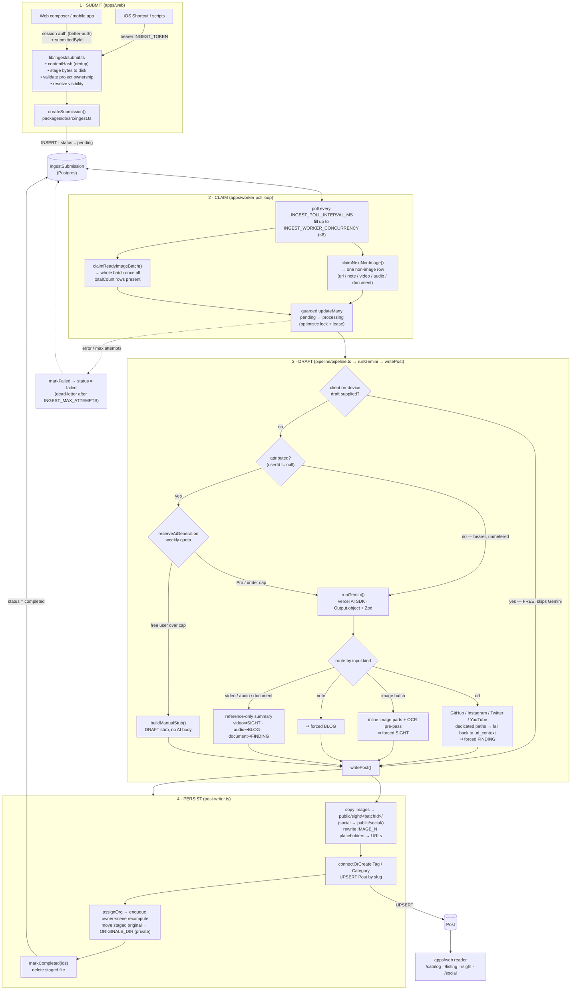
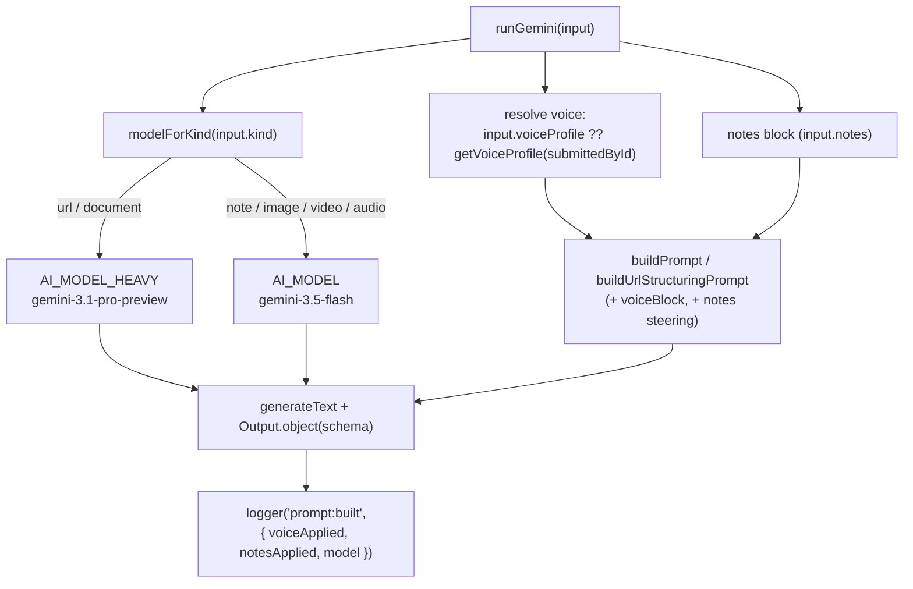

# Ingestion flow

How a submitted URL, note, image, or file becomes a published `Post`.

The ingest pipeline is a **producer/consumer queue backed by the `IngestSubmission`
table**. `apps/web` (producer) and `apps/worker` (consumer) never call each other
directly — they share only the Postgres DB and the `@repo/db` helpers. State machine:

```
pending → processing → completed | failed
```

> Source of truth for this doc: `apps/web/lib/ingest/submit.ts`,
> `apps/worker/src/index.ts`, `apps/worker/src/pipeline/*`, `packages/db/src/ingest.ts`.
> Each section cites the file:line that backs its claims so the doc can be re-verified
> against the code.

---

## Diagram



---

## 1 · Submit (apps/web)

All submission logic funnels through `apps/web/lib/ingest/submit.ts`: it computes a dedup
`contentHash`, stages binary bytes to disk, validates project ownership, resolves
post visibility, and calls `createSubmission` (`packages/db/src/ingest.ts:49`), which
inserts a row as `pending`.

**Two auth paths, same submit core:**

| Route | Auth | Used by | Attribution |
|---|---|---|---|
| `/api/ingest`, `/api/ingest-images`, `/api/ingest-file` | bearer `INGEST_TOKEN` (constant-time compare in `lib/ingest/auth.ts`) | iOS Shortcuts / scripts | none |
| `/api/app/ingest`, `/api/app/ingest-images`, `/api/app/ingest-file` | session (better-auth) | web composer + mobile | `submittedById` |

Visibility rules (`submit.ts` `resolveVisibility`): `FRIENDS` requires an attributed
submitter; an unattributed bearer ingest drops to `null` (worker keeps the
`Post.visibility` `PRIVATE` default).

## 2 · Claim (apps/worker poll loop)

`apps/worker/src/index.ts` polls every `INGEST_POLL_INTERVAL_MS` (default 5000ms) and
fills up to `INGEST_WORKER_CONCURRENCY` in-flight jobs (default 2, capped at
`MAX_WORKER_CONCURRENCY` = 8).

- `claimNextNonImage()` (`ingest.ts:130`) grabs one non-image row — kind in
  `url`/`note`/`video`/`audio`/`document` (`ingest.ts:134`).
- `claimReadyImageBatch()` (`ingest.ts:155`) waits until all `totalCount` rows of an image
  `batchId` are present, then claims the whole batch as one SIGHT post.

Claiming flips `pending → processing` via a guarded `updateMany` (count-check =
optimistic lock). Stuck `processing` rows are reclaimed after the lease
(`INGEST_LEASE_MS`, default 600000ms / 10 min) via `reclaimStaleProcessing` /
`reclaimStaleImageBatches`. A row dead-letters to `failed` after `INGEST_MAX_ATTEMPTS`
(default 3) processing attempts. Shutdown drains active jobs for
`INGEST_SHUTDOWN_DRAIN_MS` (default 30000ms).

## 3 · Draft (pipeline/pipeline.ts)

`processIngest` runs three drafting paths in priority order
(`apps/worker/src/pipeline/pipeline.ts`):

1. **Client draft** — a valid on-device draft from the mobile app (`tryClientDraft`)
   skips Gemini entirely and is **FREE / never metered**.
2. **Server Gemini, metered** — for an *attributed* ingest (`userId != null`), gate on the
   user's weekly quota (`reserveAiGeneration`); Pro users always pass. **Unattributed bearer
   ingests (`userId == null`) skip the quota gate entirely** (`pipeline.ts:84`) and run
   Gemini unmetered — there's no one to attribute.
3. **Manual stub** — a free user over the limit gets a `DRAFT` stub (no AI body) via
   `buildManualStub` instead of a failure, so the ingest still lands.

`runGemini` (`gemini-runner.ts`) uses the Vercel AI SDK (`generateText` +
`Output.object(zodSchema)`) so output is schema-validated. Routing by `input.kind`:

| `input.kind` | Path | Forced type |
|---|---|---|
| `url` | Dedicated **GitHub**, **Instagram** (Apify), **Twitter**, **YouTube** (transcript) paths, each **falling back to `url_context`**; multi-URL / plain URLs go straight to `url_context`. `url_context` tool fetches/summarizes, then a second call structures it (tools + JSON mode can't coexist in one Gemini call). | `FINDING` |
| `image` | Inline image parts + a concurrent OCR pre-pass. | `SIGHT` |
| `note` | Compose a BLOG entry from the author's notes. | `BLOG` |
| `video` / `audio` / `document` | Reference-only summary of the attached file (submitted via the `ingest-file` routes); no media embedded in the post. | `video` → `SIGHT`, `audio` → `BLOG`, `document` → `FINDING` |

The post **type is forced by the worker after the model returns** (`toGeminiOutput`'s
`forcedType` arg, `gemini-runner.ts:161`) so a model regression can't drift the type.

## 4 · Persist (post-writer.ts)

`writePost` (`apps/worker/src/pipeline/post-writer.ts`, replaces copt-dev's mdx-writer):

1. Copies image batches into `apps/web/public/sight/<batchId>/` (override `SIGHT_IMAGE_DIR`;
   the Instagram/social path uses `SOCIAL_IMAGE_DIR` → `public/social/`).
2. Stores images as **structured metadata** on `Post.images` (a JSON array of
   `{url, alt}`, `post-writer.ts:458`) — the post **body contains no image references**.
   Gemini is explicitly instructed not to write image markdown/URLs in the body
   (`gemini-runner.ts:88`). (The file-header comment still mentions "rewrite `IMAGE_N`
   placeholders" — that's stale; `IMAGE_N` appears nowhere in the actual logic.)
3. `connectOrCreate`s Tag/Category rows and **upserts** the `Post` keyed by **source
   identity** (`providerId_sourceRecordId`, `post-writer.ts:448`), not by slug; the slug is
   resolved separately (`resolveSlug`, `post-writer.ts:389`) and only used on create.
4. Moves the staged original into the private `ORIGINALS_DIR`
   (`{userId}/{submissionId}/{file}`), recording `IngestSubmission.retainedFilePath`.
5. Marks the submission(s) `completed` (`markCompleted`, `ingest.ts:320`) and deletes the
   staged file.

The owner-scene recompute is **not** triggered by `writePost` — it's enqueued earlier, in
the assign-org stage (`enqueueSceneRecompute`, `assign-org.ts:307`). Per-claim pipeline
order is `writePost → assignOrg (enqueue recompute) → retain originals → markCompleted`.

### Serving worker-written media

The worker writes images at **runtime**, but `next start` only serves `public/` files that
existed at build time. Two catch-all route handlers bridge the gap:
`apps/web/app/sight/[...path]/route.ts` and `apps/web/app/social/[...path]/route.ts`
(both via `apps/web/lib/media/serve-media.ts`, path-traversal-guarded). In production a
Caddy `file_server` fronts these paths off disk; the Next handlers are the dev/fallback path.

### Retained originals (private)

Unlike `/sight` + `/social`, retained originals live under `ORIGINALS_DIR` (default
`<repo>/private-uploads/originals`) — **not** under `public/`, never fronted by Caddy.
Access is owner-gated only: `GET /api/app/posts/[slug]/source`,
`GET /api/app/posts/[slug]/notes`, and `DELETE /api/app/posts/[slug]` (which removes the
post + source rows + retained files).

---

## Generation (models, voice & notes)

The draft step (`runGemini`, `apps/worker/src/pipeline/gemini-runner.ts`) is where the AI
writes the post. Models, the user's voice, and the user's notes all converge here.

### Model per stage (tiered)

Model ids resolve through `apps/worker/src/lib/ai-config.ts` and are env-overridable.
Text drafting is **tiered** by `modelForKind`: the high-value paths use a Pro model, the
rest use a faster/cheaper Flash model.

| Stage | Model (default) | Env | Tier |
|---|---|---|---|
| url / FINDING + github/twitter/youtube + document **draft** | `gemini-3.1-pro-preview` | `AI_MODEL_HEAVY` | heavy (Pro) |
| note / image (SIGHT) / video / audio drafting | `gemini-3.5-flash` | `AI_MODEL` | standard (Flash) |
| Instagram digest (tone-neutral extraction, templated body) | `gemini-3.5-flash` | `AI_MODEL` | standard (Flash) |
| YouTube video understanding | `gemini-2.5-pro` | `YOUTUBE_AI_MODEL` | (needs fileData) |
| Image OCR pre-pass | = `AI_MODEL` | `AI_MODEL` | standard |
| PDF text extraction (document step 1) | = `AI_MODEL` | `AI_MODEL` | standard |
| Cover-image brief / render | `gemini-2.5-flash` / `gemini-3-pro-image-preview` | `IMAGE_GEN_BRIEF_MODEL` / `IMAGE_GEN_MODEL` | image |

> `AI_MODEL_HEAVY` is a `-preview` id (there is no stable Gemini-3 Pro GA: `gemini-3-pro`
> 404s, `gemini-3-pro-preview` is deprecated). If Google retires it, bump the env and
> re-verify with `bun run gen:try`.



### How voice & notes reach the model

- **Voice** (the user's settings → `User.voiceProfile`) is sanitized + wrapped in a
  delimited, style-only block by `buildVoiceInstruction`
  (`packages/ingest-draft/src/voice.ts`) and appended to the prompt. `runGemini` resolves it
  via an **override seam** — an explicitly-passed `input.voiceProfile` wins, otherwise it
  fetches from the DB by `submittedById`. It's applied on every prose path
  (note/url/image/file/twitter/youtube/github/document). It is **not** applied to the
  Instagram path, whose body is a deterministic spec assembled from a structured
  extraction (no voiced prose to shape) — by design.
- **Notes** (the user's free text) are appended as an intent-steering block on every server
  path. On the on-device draft path the notes are consumed locally before drafting, so the
  worker doesn't re-inject them (avoids duplication).
- **Proof**: `runGemini` emits a `prompt:built` stage log with `voiceApplied`/`voiceChars`/
  `notesApplied`/`notesChars`/`model` — surfaced in worker logs and asserted by the harness.

### Blackbox harness — `gen:try`

Run a real Gemini generation outside the daemon, no DB required (only `GEMINI_API_KEY`):

```sh
bun run gen:try --kind note --note "weekend trip" --voice "wry, lowercase"
bun run gen:try --kind url  --url https://example.com --notes "focus on pricing"
bun run gen:try --kind image --image apps/web/public/IMG_4297.JPG --voice "..."
bun run gen:try --kind note --note "..." --model gemini-3.5-flash --temp 0.5   # sweep
```

It prints the drafted `{title, body, tags, categories, type}` plus a **PROOF** block
(`voiceApplied` / `notesApplied` / `model`). Source: `apps/worker/scripts/gen-try.ts`. Use
it to verify a model id resolves before changing `AI_MODEL` / `AI_MODEL_HEAVY`.

---

## Environment knobs

| Var | Default | Effect |
|---|---|---|
| `INGEST_POLL_INTERVAL_MS` | 5000 | Worker poll cadence |
| `INGEST_WORKER_CONCURRENCY` | 2 (max 8) | In-flight jobs |
| `INGEST_LEASE_MS` | 600000 | Stuck-row reclaim window |
| `INGEST_MAX_ATTEMPTS` | 3 | Dead-letter threshold |
| `INGEST_SHUTDOWN_DRAIN_MS` | 30000 | Graceful-shutdown drain |
| `SIGHT_IMAGE_DIR` / `SOCIAL_IMAGE_DIR` | `public/sight` / `public/social` | Public post-image roots |
| `ORIGINALS_DIR` | `<repo>/private-uploads/originals` | Private retained originals |
| `AI_MODEL` | `gemini-3.5-flash` | Standard (Flash) text model — note/image/video/audio |
| `AI_MODEL_HEAVY` | `gemini-3.1-pro-preview` | Pro text model — url/FINDING + document |
| `AI_TEMPERATURE` | `0.7` | Generation temperature |
