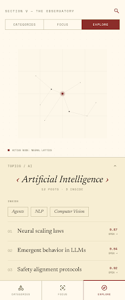

# Mobile "Explore" — focused-node traversal synced with a 3D constellation

Date: 2026-06-18
Status: approved (brainstorm) → implementing
Stitch project: `8122949725615028273` · design system `assets/6083741246919490693`
Stitch screen: `383ce07e1d5045a89cf922b812c733f6` ("The Observatory — Explore Focus")

## Problem

The mobile Tree tab (`apps/mobile/src/app/(tabs)/tree.tsx`) is a collapsible text
outline + Focus grid that drills into flat index lists. A separate 3D screen
(`apps/mobile/src/app/space.tsx`) renders the embedding graph with
`@react-three/fiber/native` but is **orphaned** — not reachable from the tab flow. The two
never talk, so there's no easy, spatial way to wander your taxonomy and "see what is what."

## Solution

A third **"Explore"** mode in the Tree tab: a single taxonomy node **in focus** that the
user flips through **left/right between siblings**, paired with a **3D constellation hero**
whose camera flies to the focused node and pulses it oxblood. Both surfaces are driven by
the _same_ `useSceneSelection` state so they can never disagree.

No backend changes — every `SceneNode` already carries a PCA `position: [x,y,z]`, and
`@repo/embedding-scene` already exposes the hierarchy (`categoryChildren`), posts
(`subtreeIndex`/`linkedPosts`), counts (`nodeCounts`), and the shared `useSceneSelection`.

## Interaction model

- **Swipe ◄ / ►** (or tap the title chevrons) — cycle **siblings** (same `parentPath`),
  wrapping at the ends. Camera flies + glow moves to the new node.
- **Tap a child chip** (the `INSIDE:` row) — drill **down** into that child category.
- **Tap the breadcrumb** — go **up** to the parent.
- **Tap a post** — open `/post/[slug]`.
- **Drag the 3D hero** — free orbit (doesn't change focus). Gestures don't collide:
  orbit lives inside the Canvas's R3F event system (`OrbitBackdrop`), sibling swipes live
  on the plain-RN card below.

(Vertical swipe-to-drill was dropped — it would fight the posts-list vertical scroll;
taps cover up/down instead.)

## Layout (top → bottom)

1. Pinned header: `Eyebrow` "Section V — The Observatory" + `PageHeader` + the
   `SegmentedControl` with **Categories / Focus / Explore**.
2. **3D constellation hero** (~45% height): nodes as ink dots, thin ink edges; the focused
   node is larger, oxblood, glowing + gently pulsing; direct neighbors emphasized; the rest
   dimmed. Camera orbits/looks at the focused node and eases between siblings on swipe. An
   `ACTIVE NODE: <label>` caption sits under the map.
3. **Focused-node card** (raised paper `#eadfc6`, hairline top rule):
   - Breadcrumb (`TOPICS / AI`, tap → parent).
   - Title row: `‹  Title  ›` (serif, large) + `N POSTS · M INSIDE` caption.
   - `INSIDE:` row of tappable child-category chips (1px ink border, serif).
   - Hairline divider.
   - Posts list: `01` mono number · serif title · oxblood match score · `OPEN →`.
4. Tiny mono hint: `SWIPE ‹ › SIBLINGS · TAP A CHILD TO DRILL IN`.

## Aesthetic

Editorial constellation, on-brand with Sirius tokens (`apps/mobile/src/constants/theme.ts`):
paper cream `#f3ecdc`, ink `#1c1612`, oxblood accent `#8b2e2a`, serif (New York) +
monospace (SF Mono), sharp 0px corners, 1px hairline rules, no shadows. The oxblood focus
node is the single spot of color in the map.

## Architecture / components

- `apps/mobile/src/app/(tabs)/explore-focus.ts` — `useExploreFocus(scene)`: owns
  `focusedId`; derives `focused/siblings/index/count/parent/children` from
  `categoryChildren` + `nodeCounts`; actions `next()/prev()/up()/focus(id)`. Pure indexing
  over existing queries — no query logic duplicated.
- `packages/embedding-scene/src/react/space-scene.tsx` — extended with **optional**
  `palette` + `focusedId` props (defaults reproduce today's web colors, so the web
  Observatory is visually unchanged). A small `useFrame` pulse on the focused node.
- `apps/mobile/src/app/(tabs)/explore-view.tsx` — the screen: `Canvas` + a focus-aware
  `CameraRig` (reuses the damped-orbit + mandatory expo-gl `getContext().getError()` flush
  from `space.tsx:66-85`) + `OrbitBackdrop`; the `FocusCard` (gesture-handler horizontal
  swipe → siblings; breadcrumb/chips/posts). Calls `useSceneSelection.select(focusedId)` so
  the hero highlights the same node.
- `tree.tsx` — adds the third `<Segment>` and renders `<ExploreView>`; shares
  `SCENE_QUERY_KEY`/`fetchScene` (no new fetch). The orphaned `space.tsx` is folded in
  (retire pending confirmation).

## Reused (no new backend, no duplicated logic)

`categoryChildren`, `subtreeIndex`, `nodeCounts`, `linkedPosts`, `useSceneSelection`
(`@repo/embedding-scene`); the `CameraRig`/`OrbitBackdrop` pattern + expo-gl flush
(`space.tsx`); post-row styling (`tree/[...node].tsx`); `Screen`/`Eyebrow`/`PageHeader`
(`components/sirius.tsx`); `SegmentedControl`/`Segment` (`components/segmented.tsx`); Sirius
tokens (`constants/theme.ts`).

## Verification

Run the app (`bun run dev` interactively), iOS Simulator, Tree → Explore: confirm the
focused node glows/pulses + camera framed; swipe ◄► moves focus AND the camera flies + glow
follows; child chip drills, breadcrumb goes up, post opens the reader; orbit-drag rotates
without changing focus. `bun run lint` + `bun run check-types` clean. Watch for the expo-gl
frozen/black-frame symptom (the per-frame GL flush must be present). No test runner exists.
